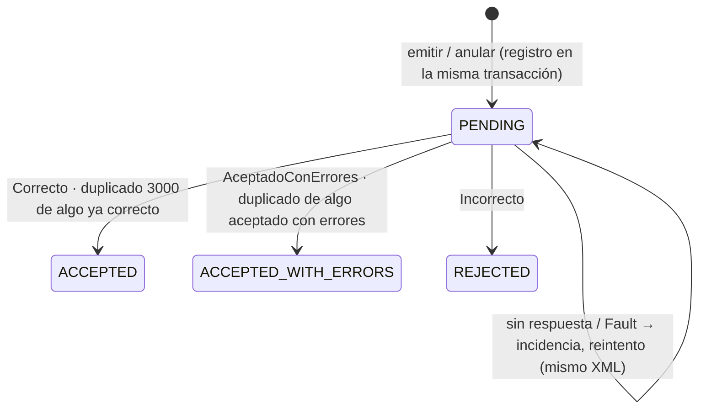

# Integración con la AEAT (✅ Fase 6)

Remisión de los registros VERI*FACTU al servicio web de la AEAT. Decisión: [ADR-005](../decisions/ADR-005-aeat-integration.md).

Fuentes oficiales, copiadas en [`packages/verifactu/specs/1.0`](../../packages/verifactu/specs/README.md):
- descripción de los servicios web v1.0.3;
- `SistemaFacturacion.wsdl`;
- `RespuestaSuministro.xsd`;
- validaciones v1.2.2 y `errores.properties`;
- Orden HAC/1177/2024, arts. 4, 5 y 16.

## Componentes

| Componente | Dónde | Responsabilidad |
|---|---|---|
| Entornos | `aeat-client/environment.ts` | `FACTURALIBRE_ENV=production` envía a `www1.agenciatributaria.gob.es`, el servicio VERI*FACTU de producción. `test` envía a `prewww1.aeat.es`, el portal de pruebas externas. **Cualquier otro valor** envía al simulador local (R-19): desde desarrollo nunca se contacta con la AEAT. |
| Transporte | `aeat-client/transport.ts` | SOAP 1.1 document/literal por HTTPS, en UTF-8 y con `SOAPAction` vacío, autenticado con el PKCS#12 del contribuyente. Tiene un tiempo máximo de espera. Solo admite HTTP contra la propia máquina. |
| Respuesta | `aeat-client/response.ts`, `submission.ts` | Lee `RespuestaRegFactuSistemaFacturacion` o un SOAP Fault y decide qué hacer: **respondido**, **reintentar** (sin conexión, Fault de servidor o respuesta ilegible) o **revisar** (Fault de cliente). Después fija el estado de cada registro. |
| Control de flujo | `aeat-client/schedule.ts` | Espera el `TiempoEsperaEnvio` devuelto por la AEAT (60 s al principio) o envía antes si se acumulan 1.000 registros (art. 16.2). Tras una incidencia reintenta con espera creciente, de 1 minuto a **como máximo 1 hora** (art. 16.4). |
| Certificados | `aeat-client/certificates.ts`, `tenancy/certificates.ts` | Cifrado por sobre: una clave AES-256-GCM propia de cada certificado, envuelta con la `CERTIFICATE_KEK` del despliegue, que no está en la base de datos. Al subirlo se comprueba que el PKCS#12 se abre con su contraseña. Solo se descifra en memoria, en el worker, para cada envío. Solo lo gestiona quien administra el contribuyente (`certificates.manage`). |
| Simulador | `aeat-client/simulator.ts` | Responde con el formato oficial (sus respuestas validan contra `RespuestaSuministro.xsd`) y con códigos del catálogo oficial: **2000** (huella incorrecta), **3000** (duplicado) y **3002** (no existe el registro). Recalcula la huella de cada registro. No sustituye al portal de pruebas de la AEAT. |
| Worker | `apps/worker/src/submitter.ts` | Bucle de envío (ver abajo). |
| Avisos | web: `SubmissionNotice` | En todas las pantallas del contribuyente, mientras dure una incidencia, avisa de cuántos registros faltan por remitir y por qué (art. 16.4). También avisa de los registros rechazados. |

## Ciclo del worker

1. **Reclamar.** El worker reclama una facturación con registros pendientes cuyo turno (`next_send_at`) ha llegado. Lo hace con una concesión de 5 minutos y `FOR UPDATE SKIP LOCKED`: dos workers nunca envían lo mismo, y si uno muere, otro lo retoma después.
2. **Enviar.** Envía hasta 1.000 registros pendientes, en el orden de la cadena y con **el XML guardado al generarlos**: un reintento nunca crea un registro nuevo. Si hay una incidencia en curso, la cabecera declara `RemisionVoluntaria/Incidencia = S` (art. 16.4).
3. **Aplicar la respuesta**, registro a registro: estado, CSV (que no se puede recuperar después), y código y descripción oficiales del error.
4. **Programar el siguiente turno**:
   - con respuesta: el control de flujo;
   - sin conexión, con Fault de servidor o con respuesta ilegible: incidencia (`failing_since`, `last_error`) y reintento creciente;
   - con Fault de cliente o sin certificado: revisar y reintentar cada hora.

Un **duplicado (3000)** de un registro que la AEAT ya tiene como correcto se interpreta así: la respuesta anterior se perdió y el registro ya está presentado. Por eso cuenta como aceptado.

## Permisos

El worker es un proceso de plataforma que remite los registros de todas las organizaciones, igual que hace con el outbox. Lee solo lo necesario para remitir:
- facturaciones y registros;
- NIF y nombre de los contribuyentes;
- certificados cifrados.

Solo actualiza las columnas de la remisión (GRANT por columna) y no lee facturas, clientes, productos ni usuarios. Lo prueba `rls.test.ts`.

## Pendiente

- ⛔ **Probar contra el portal de pruebas externas de la AEAT** con un certificado real de pruebas (`FACTURALIBRE_ENV=test`). Todo lo anterior está probado con el simulador y con un servidor TLS local, nunca con la AEAT.
- ⏳ Endpoints para certificado de sello (`www10` / `prewww10`). Hoy se usa el de certificado personal o de representante.
- ⏳ Subsanación de registros rechazados (`Subsanacion = S`). Hoy quedan **rechazados** y se avisa al usuario para que los revise.
- ⏳ Consulta de registros presentados (`ConsultaFactuSistemaFacturacion`) y renuncia a VERI*FACTU (`FechaFinVeriFactu`).
