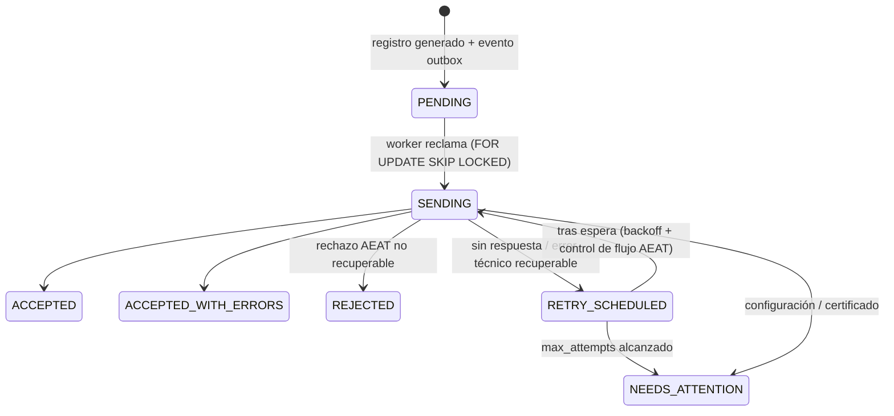

# Integración con la AEAT (diseño, Fase 6)

Estado: 📄 diseño. Nada implementado. Endpoints, operaciones y mensajes ⛔ pendientes de leer en la documentación oficial ([legal-references](../compliance/legal-references.md)); **no se inventarán**.

## Lo confirmado

- Servicios web VERI*FACTU en producción desde el 23/04/2025 (FAQ desarrolladores v1.3).
- Existe un portal de pruebas externas (`preportal.aeat.es`) y los WSDL/XSD se publican en `prewww2.aeat.es` (preproducción).
- Para remitir se necesita certificado electrónico cualificado; se admite el de un representante, apoderado o colaborador social (FAQ de la sede).
- Si no hay respuesta, se reenvía hasta obtenerla; las caídas amplían los plazos y nunca deben detener la facturación (FAQ de la sede).

## Componentes

| Componente | Responsabilidad |
|---|---|
| `aeat-client/environments` | Mapa `FACTURALIBRE_ENV → entorno AEAT`. `development` → **ninguno** (simulador local); `test` → preproducción; `production` → producción. La URL de producción solo se carga si `FACTURALIBRE_ENV=production`. |
| `aeat-client/certificates` | Descifra el certificado en memoria solo durante el envío. Nunca lo registra ni lo expone al navegador. |
| `aeat-client/soap` | Sobre construido a partir de XML validado contra los XSD versionados. |
| `aeat-client/submission` | Un envío = un lote de registros de **una** facturación; idempotencia por id de lote; persistencia de cada intento. |
| `aeat-client/responses` | Traducción de la respuesta oficial a estados internos; se guarda la respuesta íntegra. |

## Máquina de estados interna (borrador)

Estados **internos**; los códigos oficiales se guardan aparte. Un reintento reenvía exactamente el mismo registro (misma huella).

## Clasificación de errores

Validación local · configuración · certificado · conexión · SOAP · esquema · rechazo AEAT · recuperable / no recuperable. Los logs nunca incluyen XML completo con datos personales, certificados, claves ni contraseñas.

## Entornos

No se envían registros reales desde desarrollo ni pruebas; las pruebas automáticas usan un simulador local y certificados autogenerados, nunca certificados reales.
