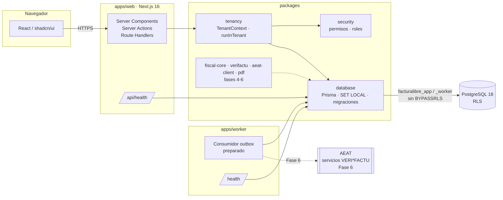

# Arquitectura general

FacturaLibre es un **monolito modular** en un monorepo pnpm + Turborepo: una aplicación web Next.js, un worker Node.js y paquetes de dominio/infraestructura con dependencias en una sola dirección. Una única instancia PostgreSQL con esquema compartido, aislada por `tenant_id`/`taxpayer_id`, claves foráneas compuestas y Row Level Security.



## Módulos y estado

| Módulo | Responsabilidad | Estado |
|---|---|---|
| `packages/database` | Esquema Prisma, migraciones, roles de BD, contexto transaccional (`withSecurityContext`), arnés de pruebas con PostgreSQL real | ✅ |
| `packages/security` | Catálogo único de permisos, matriz rol→permisos, recorte por acceso al contribuyente, reglas anti-escalada | ✅ |
| `packages/tenancy` | `resolveTenantContext` (verificación en servidor) y `runInTenant` (único acceso a datos de tenant) | ✅ |
| `apps/web` | UI, Server Actions, health check | 🧩 (solo página pública y `/api/health`) |
| `apps/worker` | Procesos asíncronos (outbox, envíos AEAT, reintentos) | 🧩 (health check y ciclo de vida; sin procesamiento) |
| Autenticación | Registro, sesión, verificación, recuperación | 📄 [ADR-006](../decisions/ADR-006-authentication.md); tablas preparadas |
| `fiscal-core` | Cálculos decimales, numeración, rectificativas | ⏳ Fase 4 |
| `verifactu` | Registros, huella, encadenamiento, QR, XML | 📄 diseño inicial · ⛔ especificaciones técnicas por leer íntegras |
| `aeat-client` | SOAP, certificados, envíos, respuestas | 📄 diseño inicial |
| `pdf`, `email`, consulta de auditoría | Documentos, notificaciones | ⏳ |

## Regla de dependencias

```
apps/web, apps/worker ──► tenancy ──► security
                     └──────────────► database
futuros: verifactu ──► fiscal-core (puro);  aeat-client ──► verifactu
```

- Ningún paquete importa de `apps/*`.
- `security` y el futuro `fiscal-core` son **puros** (sin E/S): pruebas unitarias y de mutación.
- Solo `database` importa el cliente Prisma generado (regla ESLint `no-restricted-imports`).
- Todo acceso a datos de un tenant pasa por `runInTenant` (ver [application-flow](application-flow.md)).

## Procesos asíncronos (diseño)

Patrón **Transactional Outbox** 🧩: la tabla `outbox_events` existe con RLS, permisos y `idempotency_key` única; la aplicación insertará el evento en la misma transacción que el cambio de negocio. El worker (rol `facturalibre_worker`) reclamará eventos con `SELECT … FOR UPDATE SKIP LOCKED`, procesará cada uno estableciendo el contexto del **tenant del propio evento**, registrará cada intento y aplicará `max_attempts` (sin reintentos infinitos). La cola duradera es PostgreSQL (sin Redis). Ver [ADR-001](../decisions/ADR-001-architecture.md).

## Extracción futura a servicios

Cada paquete expone una API pública (`src/index.ts`) y no comparte estado mutable. `aeat-client` + worker son el primer candidato a servicio independiente (comunicación solo por outbox y tablas propias).
