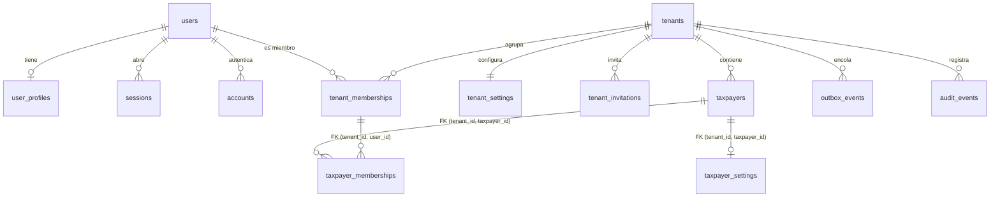

# Modelo de datos (Fase 1)

Fuente de verdad: `packages/database/prisma/schema.prisma` + migraciones SQL. Estado: ✅ implementado y migrado (PostgreSQL 18).

## Diagrama entidad-relación

## Entidades

| Tabla | Ámbito | Propósito |
|---|---|---|
| `users` | Global | Identidad de una persona física (email único en minúsculas). No pertenece a ningún tenant. |
| `user_profiles` | Global | Preferencias (idioma, zona horaria). Separado de la identidad de autenticación. |
| `sessions`, `accounts`, `verifications` | Global | Forma requerida por la librería de autenticación ([ADR-006](../decisions/ADR-006-authentication.md)). Solo accesibles por el rol `facturalibre_auth`. `accounts.password` guarda **hash**. |
| `tenants` | Organización | Espacio de trabajo. `slug` solo para URL; nunca autoriza. `ACTIVE`/`DEACTIVATED` coherente con `deactivated_at` (CHECK). |
| `tenant_settings` | Organización | 1:1. Idioma, zona horaria, moneda (CHECK `EUR`). |
| `tenant_memberships` | Organización | Usuario ↔ tenant con `role`, `taxpayer_scope` y `status`. Único `(tenant_id, user_id)`. **Un solo OWNER** por tenant (índice único parcial); el OWNER siempre tiene `ALL_TAXPAYERS` (CHECK). |
| `tenant_invitations` | Organización | Invitación por email con **hash SHA-256 del token** (nunca el token). Nunca rol OWNER (CHECK). Una pendiente por (tenant, email) (índice parcial). Aceptada y revocada son excluyentes (CHECK). |
| `taxpayers` | Organización | Obligado tributario emisor. NIF de 9 caracteres alfanuméricos en mayúsculas (CHECK; el dígito de control se valida en `@facturalibre/domain` › `parseNif`, que además deduce el tipo de persona). Único `(tenant_id, nif)`; el mismo NIF **puede** existir en otro tenant (empresa y su gestoría): son facturaciones distintas ([VERI*FACTU](../verifactu/technical-overview.md)). Sin DELETE: se desactiva. |
| `taxpayer_settings` | Contribuyente | Preferencias no fiscales (plazo de pago, pie de factura). |
| `taxpayer_memberships` | Contribuyente | Acceso de un miembro a un contribuyente concreto (`READ_ONLY`/`FULL`). |
| `audit_events` | Organización (o global si `tenant_id` NULL) | Registro append-only. |
| `outbox_events` | Organización | Transactional outbox: `idempotency_key` única, `attempts ≤ max_attempts` (CHECK). |
| `customers` | Contribuyente | Destinatarios. NIF opcional (validado en el dominio), único por contribuyente si existe; marca de recargo de equivalencia. |
| `products` | Contribuyente | Productos y servicios guardados: precio sin IVA (diezmilésimas) y tipo de IVA (CHECK de tipos admitidos). |
| `invoice_series` | Contribuyente | Series por año y tipo (`F{año}` ordinarias, `R{año}` rectificativas); `next_number` solo avanza al emitir. Sin DELETE. |
| `invoices` | Contribuyente | Borrador (sin número) o emitida (número, fecha, instantáneas de emisor y destinatario). Importes en céntimos calculados por fiscal-core. Inalterable una vez emitida (trigger). FKs compuestas por contribuyente a cliente, serie (y tipo de serie) y factura rectificada. |
| `invoice_lines` | Contribuyente | Líneas con cantidad (3 dec.), precio (4 dec.), descuento y tipo de IVA (las exentas con su causa E1/E4/E6); base calculada por fiscal-core. Inalterables si la factura está emitida. |
| `billing_systems` | Contribuyente | «Facturación» VERI*FACTU (SIF virtual): una por contribuyente; su `id` es el NumeroInstalacion. `last_sequence` = último registro de su cadena (se bloquea con `FOR UPDATE` al añadir). |
| `billing_records` | Contribuyente | Registros de alta y anulación encadenados: secuencia, huella, huella anterior, FechaHoraHusoGenRegistro exacta, campos de la huella y XML exacto del registro. Un trigger comprueba el enlace con el anterior al insertar y otro los hace inalterables (solo cambia el estado de la remisión). Ver [ADR-008](../decisions/ADR-008-verifactu-records.md). |

Identificadores: `uuid` generados por `uuidv7()` de PostgreSQL 18. Fechas: `timestamptz(6)`.

## Restricciones de tenant

La base de datos impide asociar filas de tenants distintos **aunque se ignore RLS** (probado con el rol propietario):

| Relación | Mecanismo |
|---|---|
| `taxpayer_settings` → `taxpayers` | FK compuesta `(tenant_id, taxpayer_id) → taxpayers(tenant_id, id)` |
| `taxpayer_memberships` → `taxpayers` | FK compuesta `(tenant_id, taxpayer_id)` |
| `taxpayer_memberships` → `tenant_memberships` | FK compuesta `(tenant_id, user_id)`: solo miembros del **mismo** tenant; al borrar la membresía se borran sus accesos |
| Futuras tablas fiscales (clientes, series, facturas, registros) | Misma regla: `(tenant_id, taxpayer_id, …)` con FKs compuestas hacia `taxpayers(tenant_id, id)` y entre sí |

Borrado: `RESTRICT` en todo lo organizacional y fiscal; `CASCADE` solo en datos derivados de identidad (`sessions`, `accounts`, `user_profiles`) y en accesos dependientes de una membresía.

## Reglas obligatorias para tablas futuras

1. `tenant_id uuid NOT NULL`; si es fiscal, también `taxpayer_id uuid NOT NULL`.
2. `@@unique([tenantId, id])` si otras tablas la referencian; FKs compuestas hacia ella.
3. `ENABLE ROW LEVEL SECURITY` + políticas + GRANTs en la misma migración. La prueba de catálogo falla si una tabla de `public` queda sin RLS.
4. Datos fiscales emitidos: sin UPDATE/DELETE para el rol de aplicación; correcciones mediante nuevos registros.
5. Instantáneas: una factura/registro copia los datos del emisor y del cliente en el momento de emisión; editar un `taxpayer` no altera registros emitidos.
