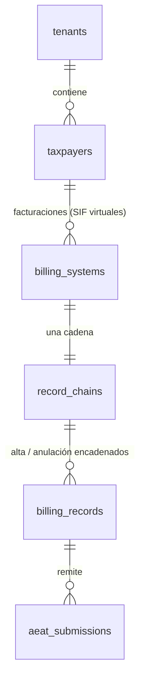

# VERI*FACTU — visión técnica (Fase 0)

> Lo verificado en fuentes oficiales y el diseño derivado. **Fase 5 (25/11/2026): ✅ implementado** — registros de alta y anulación, huella encadenada, XML conforme a los XSD 1.0 y QR, siguiendo los documentos oficiales copiados en [`packages/verifactu/specs/1.0`](../../packages/verifactu/specs/README.md). Las decisiones y lo pendiente de confirmar están en [ADR-008](../decisions/ADR-008-verifactu-records.md). La remisión a la AEAT es la Fase 6.

## 1. Calendario (⛔ situación cambiante)

| Hecho | Fuente | Estado |
|---|---|---|
| Plazo vigente: contribuyentes del Impuesto sobre Sociedades, antes del **1/1/2027**; resto, antes del **1/7/2027** | Nota informativa AEAT (actualizada 13/10/2026), tras el Real Decreto-ley 15/2025, de 2 de diciembre | Vigente |
| Hacienda anuncia el **5/10/2026** una *previsión* de aplazar las obligaciones pendientes del RD 1007/2023 **hasta octubre de 2028**, para alinearlas con la factura electrónica de empresarios con facturación ≤ 8 M€, y una modificación posterior para la «convergencia» técnica con la factura electrónica y ViDA, manteniendo integridad, conservación, accesibilidad, legibilidad, trazabilidad e inalterabilidad en términos «sustancialmente equivalentes» | Nota de prensa del Ministerio de Hacienda, 05/10/2026 | **Anuncio, no norma**: no se ha localizado publicación en BOE a la fecha de consulta |
| Servicios VERI*FACTU de la AEAT en producción desde el 23/04/2025 | FAQ desarrolladores v1.3 | — |

**Consecuencia de diseño:** no acoplar el dominio a fechas; modalidad y formatos versionados (§3–§5), porque es probable un cambio técnico posterior.

## 2. Identificación del SIF y ámbito del encadenamiento

Verificado en *Aclaraciones a dudas de los desarrolladores*, AEAT, **v1.3 (4/12/2025)**, apartados 3, 4, 6, 7 y 15:

- Un SIF se identifica por **NIF del obligado a expedir (OEF) + IdSistemaInformatico (2 caracteres asignados por el productor) + NúmeroInstalación**. La versión no cambia la identidad.
- El número de instalación **no puede repetirse nunca** entre SIF de un mismo OEF (pasado, presente o futuro); se recomienda *timestamp* o secuencial.
- En un SIF que lleva **varias facturaciones** (distintos OEF, o el mismo OEF con centros independientes), **cada facturación es un «SIF virtual»** con número de instalación propio y encadenamiento independiente. Un SIF «multiOT» cumple los requisitos individualmente para cada obligado.
- SaaS: `IndicadorMultiplesOT` se calcula **por usuario del SIF SaaS**: «S» si ese usuario tiene más de una facturación creada (cualquier estado), «N» si solo una.
- No se permite el uso «dinámico» (cambiar de normativa/modalidad por sesión, día o factura).
- Todos los registros de un mismo envío deben ser del mismo obligado tributario.
- Antes de generar cada registro (salvo el primero) el SIF comprueba que el último registro está correctamente encadenado y que su fecha-hora no supera en más de un minuto a la actual (OM HAC/1177/2024, art. 7.i, citado en el apartado 15).
- Un registro se identifica por Emisor + Serie y número + Fecha de expedición; la AEAT rechaza duplicados. No se puede reutilizar la numeración de facturas emitidas, ni siquiera «de prueba»; los borradores previos a la validación sí son lícitos (y los registros preparatorios que no llegan a factura deben conservarse).
- Debe mostrarse en todo momento qué obligado tributario está activo y advertir si el SIF soporta más de uno (OM art. 2.d, apartado 7).

### Diseño derivado (📄, Fase 5)

- **`billing_systems`** = una «facturación»: `(tenant_id, taxpayer_id, installation_number, modality, software_version_id)`. El encadenamiento **no** es por tenant ni global: es por facturación.
- **Unicidad del número de instalación**: como el mismo NIF puede existir en dos tenants, debe ser **global por NIF** (`UNIQUE (issuer_nif, installation_number)` en una tabla de plataforma), no por tenant; monótono y nunca reutilizado.
- **Concurrencia**: la cabeza de cada cadena se bloquea con `SELECT … FOR UPDATE` en la misma transacción que inserta el registro; únicos sobre `(chain_id, sequence)` y `previous_record_id`.
- **Instantáneas**: cada registro guarda los datos usados para la huella; es la fuente de verdad (el PDF no).
- `IndicadorMultiplesOT`: ⛔ falta decidir qué es «usuario del SIF SaaS» en nuestro modelo (¿tenant? ¿persona?) — requiere validación profesional.

## 3. Registros, huella, QR y XML (✅ Fase 5)

| Tema | Documento oficial (copia versionada) | Implementación |
|---|---|---|
| Diseños de registro | XSD `SuministroLR.xsd` / `SuministroInformacion.xsd` 1.0; `DsRegistroVeriFactu.xlsx` | `packages/verifactu/src/record.ts` y `xml.ts`: XML en el orden del XSD, validado contra él en los tests |
| Huella | Especificación de la huella v0.1.2 | `hash.ts`: SHA-256 en mayúsculas sobre «campo=valor&…»; los 3 ejemplos oficiales son tests |
| Firma electrónica | OM art. 14 | No aplica: la OM (art. 3) la excluye para los sistemas VERI*FACTU |
| QR y cotejo | Especificación del QR v0.5.0 | `qr.ts`, ficha de la factura y PDF (`packages/invoice-pdf`): URL de cotejo, nivel M, 35 mm, «QR tributario:» y «VERI*FACTU» |
| Servicios web | Descripción de los servicios web v1.0.3; `SistemaFacturacion.wsdl` | `submissionXml` y `soapEnvelope` preparados; el envío es la Fase 6 |
| Validaciones y errores | Validaciones v1.2.2; `errores.properties` | `validateAlta`: lo que la AEAT rechazaría no se emite (destinatario sin NIF, exención sin causa…) |
| Registro de eventos | `EventosSIF.xsd` | No aplica: solo para NO VERI*FACTU (OM arts. 3 y 9) |

## 4. VERI*FACTU vs NO VERI*FACTU

| | VERI*FACTU (alcance v1) | NO VERI*FACTU (futuro) |
|---|---|---|
| Remisión | Envío de cada registro a la AEAT | Conservación en el SIF; remisión por requerimiento |
| Registro de eventos | — | Obligatorio (`EventosSIF.xsd`) |
| Mención en factura | QR + «VERI*FACTU» (FAQ de la sede) | ⛔ por confirmar |
| Cambio de modalidad | Opción tácita al iniciar la remisión; se permanece al menos hasta fin del año natural | — |

Diseño: `modality` es atributo de `billing_systems`; las reglas de cada modalidad viven en módulos separados tras una interfaz común (p. ej. `RecordSink`: «remitir» vs «conservar»). Un SIF no intercala modalidades.

## 5. Ciclo de vida de un registro (📄 borrador)

`ISSUED (factura) → RECORD_GENERATED → QUEUED (outbox) → SENT → {ACCEPTED | ACCEPTED_WITH_ERRORS | REJECTED}`; `SENT → NO_RESPONSE → RETRY_SCHEDULED → SENT`.

Son estados **internos**; los oficiales se modelarán tal como figuren en `RespuestaSuministro.xsd` y en el documento de validaciones (⛔). Si no hay respuesta tras un envío, se reenvía hasta obtenerla (FAQ); un reintento transmite **el mismo** registro, nunca uno nuevo. Corrección de errores: nunca se altera un registro; se genera un registro de anulación o de subsanación.
